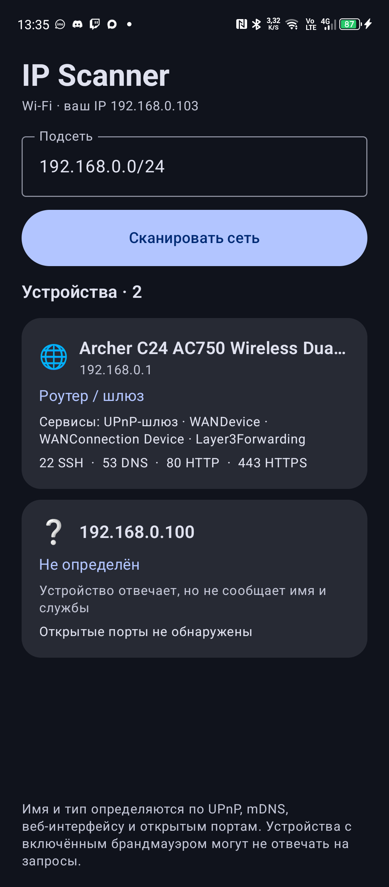

# IP Scanner

Сканер локальной сети для Android: находит устройства, показывает их имена, типы, службы и открытые TCP-порты.
Работает полностью на телефоне — без root, без сервера и без облака.

> A local network scanner for Android with device names, types, services and open TCP ports. The UI is in Russian.



## Возможности

- Сам определяет вашу подсеть (Wi-Fi, Ethernet, точка доступа), CIDR можно ввести и вручную.
- Ищет устройства сразу несколькими способами: TCP-пробы, ICMP и пассивное обнаружение через UPnP/SSDP и mDNS.
- Подписывает устройства: имя из UPnP/mDNS, обратный DNS или заголовок веб-интерфейса; тип — по службам, портам и названиям.
- Проверяет ~48 популярных TCP-портов и показывает понятные имена служб.
- Результаты появляются по мере сканирования; есть прогресс, кнопка «Остановить» и сохранение состояния при повороте экрана.
- Поддержка Android 17: запрашивает разрешение `ACCESS_LOCAL_NETWORK`.

## Как это работает

1. `ConnectivityManager` + `LinkProperties` дают свой IPv4-адрес, длину маски и шлюз.
2. Параллельно запускаются три поиска:
   - SSDP `M-SEARCH` по multicast — роутеры, телевизоры, NAS, принтеры;
   - mDNS через `NsdManager` — AirPlay, Google Cast, печать, SMB, HomeKit;
   - опрос каждого адреса подсети: TCP-подключение (успех **или** отказ `RST` означают, что хост жив), при неудаче — ICMP.
3. Для найденных хостов параллельно выполняются: сканирование портов, обратный DNS и чтение `<title>`/`Server` веб-интерфейса.
4. Тип устройства вычисляется по службам, открытым портам, имени и подсказкам со страницы.

## Сборка

Нужны Android Studio (или JDK 17+) и Android SDK 37. Поддерживается Android 7.0+ (API 24).

```bash
./gradlew :app:assembleDebug        # APK: app/build/outputs/apk/debug/app-debug.apk
./gradlew :app:testDebugUnitTest    # юнит-тесты
./gradlew :app:assembleRelease      # релизная сборка с R8
```

Файл `local.properties` с путём к SDK создаётся Android Studio и в репозиторий не попадает.

## Ограничения

- **MAC-адреса не показываются.** Начиная с Android 10 система запрещает приложениям читать ARP-таблицу, поэтому получить MAC чужих устройств без root невозможно. Функция удалена полностью.
- Устройства с включённым брандмауэром могут не отвечать ни на TCP, ни на ICMP и не появятся в списке.
- Если у устройства нет открытых портов и оно ничего о себе не анонсирует, определить имя и тип нечем — карточка честно сообщает об этом.
- За одно сканирование обрабатывается не более 1024 адресов.

## Структура

```
app/src/main/java/com/example/ipscan/
├── MainActivity.kt          точка входа и запрос разрешений
├── model/ScanModels.kt      модель устройства и типы
├── net/                     CIDR, порты, SSDP, mDNS, HTTP, обратный DNS
├── scan/NetworkScanner.kt   конвейер сканирования
└── ui/                      ViewModel и Compose-экран
```

## Лицензия

Лицензия пока не указана. Если планируете переиспользовать код, добавьте `LICENSE`
(MIT или Apache-2.0 — обычные варианты для Android-проектов).
